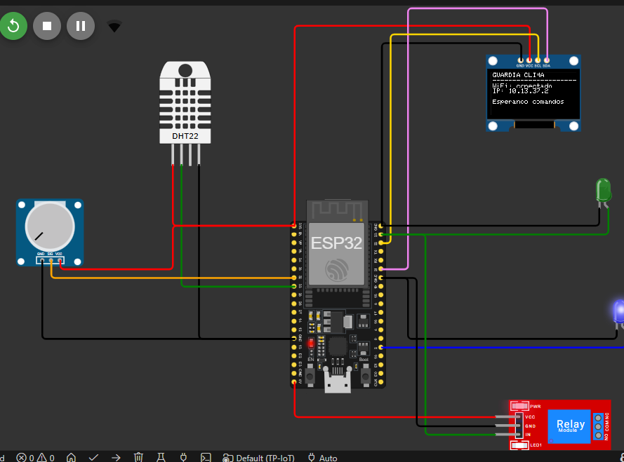
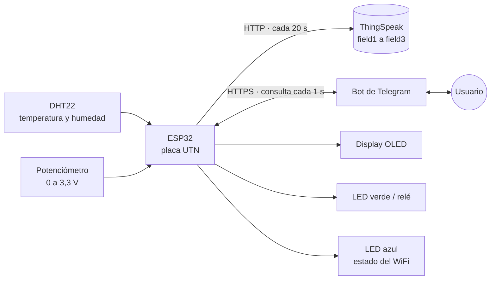

# Guardia Clima · TP Integrador IoT

Sistema embebido basado en **ESP32** para la **supervisión ambiental** y la **actuación remota**, integrado con la plataforma IoT **ThingSpeak** y un **bot de Telegram**.

Trabajo Práctico Integrador de **Tecnologías para la Automatización (TA) · 4k01 · 2026**, Universidad Tecnológica Nacional, Facultad Regional Córdoba.



---

## Qué hace

- Mide **temperatura y humedad** con el sensor DHT22 y el **voltaje** de un potenciómetro.
- Publica las lecturas en un canal de **ThingSpeak** para verlas graficadas en tiempo real.
- Se controla desde **Telegram**: consultar el clima, encender un relé por un tiempo y elegir qué se muestra en el display.
- **Vigila el potenciómetro todo el tiempo** y, si supera un umbral crítico, avisa por Telegram sin que nadie lo pida.
- Muestra estados en el **display OLED** de la placa.
- Indica el estado de la red con el **LED azul**: encendido = WiFi conectado.
- **Tolera cortes de red:** si al arrancar no hay WiFi, sigue funcionando y se conecta solo cuando la red vuelve. Una alerta que ocurre sin conexión no se pierde: se envía apenas se recupera la red.
- **Solo responde al chat autorizado:** los mensajes de otros usuarios se ignoran.

## Cómo funciona



- La ESP32 lee los sensores y guarda siempre la **última lectura válida**.
- Cada 20 s publica temperatura, humedad y voltaje en ThingSpeak.
- Cada 1 s consulta a Telegram si llegaron comandos nuevos, los ejecuta y responde.
- Sin `delay()`: en cada vuelta del `loop()` se revisan primero el relé y la alerta, y después la red. El bot procesa un mensaje por vuelta, así que el relé se apaga a tiempo aunque lleguen muchos comandos seguidos.

## Hardware

Placa de desarrollo UTN (*Evaluation Board V1.0*) con ESP32 DevKit V1 de 30 pines.

| Componente | Pin | Uso en el sistema |
| --- | --- | --- |
| Sensor DHT22 | GPIO33 | Temperatura y humedad relativa |
| Potenciómetro | GPIO32 (ADC1) | Señal analógica "crítica" (0 a 3,3 V) |
| LED verde | GPIO23 | Actuador principal (representa al relé) |
| LED azul | GPIO2 | Indicador de conexión WiFi |
| Display OLED SH1106 128×64 | SDA GPIO21 · SCL GPIO22 (I²C, 0x3C) | Estado de los componentes |

> ⚠️ Regla de la placa: **no alimentar la ESP32 desde DC y USB a la vez**.

En la simulación de Wokwi se agrega además un módulo relé en paralelo con el LED verde (mismo GPIO23), para ver el actuador real.

## Inicio rápido (simulación en Wokwi)

### Requisitos

- Visual Studio Code con la extensión **PlatformIO IDE**.
- Extensión **Wokwi Simulator** con licencia activa (es gratuita: se obtiene en [wokwi.com](https://wokwi.com) → *Pricing* → *Community*).
- Cuentas en **Telegram** y **ThingSpeak**.

### Pasos

1. **Clonar el repositorio** y abrir la carpeta en VS Code. PlatformIO descarga solo las librerías definidas en `platformio.ini`.
   ```bash
   git clone https://github.com/Axel-Villegas/TP-IoT.git
   ```
2. **Crear el bot de Telegram:** hablarle a [@BotFather](https://t.me/BotFather), enviar `/newbot`, elegir un nombre y un usuario (tiene que terminar en `bot`). BotFather responde con el **token** del bot.
3. **Escribirle al bot:** buscarlo por su usuario y enviarle `/start`. Un bot solo puede escribirle a quien le escribió primero, y la alerta automática depende de eso.
4. **Conseguir el CHAT_ID:** enviarle `/start` a [@userinfobot](https://t.me/userinfobot), que responde con el `Id` de la cuenta (un número).
5. **Crear el canal de ThingSpeak:** en *Channels → New Channel*, habilitar **Field 1** (Temperatura), **Field 2** (Humedad) y **Field 3** (Voltaje). En la pestaña *API Keys* copiar el **Channel ID** y la **Write API Key**.
6. **Configurar las credenciales:** copiar `include/secrets.example.h` como `include/secrets.h` y completarlo:

   | Constante | Valor |
   | --- | --- |
   | `WIFI_SSID` / `WIFI_PASS` | En Wokwi: `"Wokwi-GUEST"` y `""` |
   | `BOT_TOKEN` | Token del paso 2 |
   | `CHAT_ID` | Número del paso 4, entre comillas |
   | `TS_CHANNEL_ID` | Channel ID del paso 5 (sin comillas) |
   | `TS_WRITE_API_KEY` | Write API Key del paso 5 |

   `secrets.h` está en el `.gitignore`: **nunca se sube al repositorio**.
7. **Compilar:** PlatformIO → **Build** (✓) o `pio run`.
8. **Simular:** `F1` → **Wokwi: Start Simulator**. Wokwi simula el firmware compilado, así que después de cualquier cambio hay que volver a compilar.
9. **Probar:** en el monitor de Wokwi aparece la IP, el OLED muestra `WiFi: conectado` y el bot responde `/start` en Telegram.

> La red `Wokwi-GUEST` tiene salida real a internet: el bot y ThingSpeak funcionan desde la simulación.

## Uso en la placa UTN

1. **Red WiFi:** la ESP32 solo funciona en **2,4 GHz**. Se recomienda el hotspot de un celular con la banda de 2,4 GHz activada (en iPhone: *Maximizar compatibilidad*). Las redes con página de inicio de sesión no funcionan.
2. **Cambiar la red** en `include/secrets.h` (`WIFI_SSID` y `WIFI_PASS`) y **volver a compilar**.
3. **Conectar la placa por USB** (sin la fuente DC conectada).
4. **Subir el firmware:** PlatformIO → **Upload** (→) o `pio run -t upload`.
5. **Abrir el monitor serie:** PlatformIO → **Serial Monitor** o `pio device monitor` (115200 baudios).
6. Al conectarse, el **LED azul** se enciende y el OLED muestra la IP. Si la red no está disponible al arrancar, la placa espera hasta 20 s, sigue funcionando sin red y se conecta sola cuando la red aparece.

## Comandos del bot

| Comando | Qué hace |
| --- | --- |
| `/start` | Muestra el menú con botones (Ver Clima, Encender Relé, Ver Display) |
| `/clima` | Devuelve la última lectura de temperatura y humedad |
| `/releon <seg>` | Enciende el relé durante `<seg>` segundos (1 a 3600) y lo apaga solo (por defecto 5 s). Alias: `/rele on <seg>` |
| `/releoff` | Apaga el relé y cancela el temporizador. Alias: `/rele off` |
| `/thingup` | Envía el voltaje del potenciómetro a ThingSpeak en el momento (si todavía no hubo envíos o pasaron 15 s desde el último; si no, avisa en cuántos segundos sale) e indica si supera el umbral |
| `/displayled` | Muestra en el OLED el estado de los LEDs |
| `/displaypot` | Muestra en el OLED la lectura y el voltaje del potenciómetro |
| `/displaydht` | Muestra en el OLED la temperatura y la humedad |
| `/displayrele` | Muestra en el OLED el estado del relé y los segundos restantes |

Cualquier otro `/display...` se informa en el OLED como **comando no identificado**.

### Alerta automática

- Cuando el voltaje del potenciómetro cruza los **2,8 V**, el bot avisa **una sola vez**. Vuelve a avisar recién después de que el voltaje baje del umbral y lo cruce de nuevo.
- Si la placa **arranca** con el potenciómetro ya por encima del umbral, también avisa: el sistema informa una condición crítica aunque se haya reiniciado.
- Si el cruce ocurre **sin conexión**, la alerta se guarda con el voltaje y el momento del cruce, y se envía apenas vuelve la red. Si para entonces el valor ya se normalizó, se agrega un aviso con el valor actual.

## ThingSpeak

| Campo | Dato |
| --- | --- |
| Field 1 | Temperatura (°C) |
| Field 2 | Humedad (%) |
| Field 3 | Voltaje del potenciómetro (V) |

- **Envío periódico:** cada 20 s, con los tres campos.
- **Envío a pedido:** `/thingup` publica en el momento si pasaron al menos 15 s desde el último envío (límite de la versión gratuita de ThingSpeak); si no, queda pedido y sale apenas se cumple ese mínimo.
- Cada envío, periódico o pedido, reinicia el reloj, así nunca hay dos envíos a menos de 15 s.
- Si un envío falla (por ejemplo, ThingSpeak lo rechaza con `-401`), se reintenta a los 15 s: el dato no se pierde.

## Configuración

Los parámetros del sistema están en `include/config.h`. Se pueden ajustar sin tocar la lógica (después de cambiarlos, hay que volver a compilar):

| Constante | Valor | Qué controla |
| --- | --- | --- |
| `UMBRAL_VOLTAJE` | 2.8 V | Voltaje que dispara la alerta |
| `INTERVALO_THINGSPEAK_MS` | 20 000 ms | Envío periódico a ThingSpeak |
| `INTERVALO_MINIMO_THINGSPEAK_MS` | 15 000 ms | Mínimo entre envíos (límite del plan gratuito) |
| `INTERVALO_BOT_MS` | 1 000 ms | Cada cuánto se consulta a Telegram |
| `INTERVALO_DHT_MS` | 2 000 ms | Lectura del DHT22 (no admite menos de 2 s) |
| `TIMEOUT_WIFI_INICIAL_MS` | 20 000 ms | Espera máxima de la conexión al arrancar |
| `RELE_SEGUNDOS_DEFECTO` | 5 s | Duración de `/releon` sin tiempo |
| `RELE_SEGUNDOS_MAXIMO` | 3 600 s | Duración máxima de `/releon` |

Los pines también están definidos ahí (ver [Hardware](#hardware)).

## Arquitectura

El programa principal (`src/main.cpp`) solo coordina. Cada parte del sistema es una **librería propia** en `lib/`:

| Librería | Responsabilidad |
| --- | --- |
| `SensorAmbiente` | Lee el DHT22 cada 2 s y guarda la última lectura válida |
| `Potenciometro` | Lee el ADC y lo convierte a voltaje |
| `AlertaUmbral` | Decide cuándo avisar: una sola vez al cruzar el umbral |
| `Actuador` | Enciende el relé X segundos y lo apaga solo, sin bloquear |
| `Pantalla` | Todos los mensajes del display OLED |
| `Nube` | Publicación en ThingSpeak, periódica y a pedido, respetando el límite de 15 s |
| `BotTelegram` | Recibe e interpreta comandos, teclado inline y alertas |

Ninguna tarea bloquea a las demás: cada librería lleva su propio reloj con `millis()` y el `loop()` nunca usa `delay()`.

### Estructura del proyecto

```
TP-IoT/
├─ platformio.ini            ← entorno, placa y librerías
├─ diagram.json              ← circuito de Wokwi
├─ wokwi.toml                ← ubicación del firmware para Wokwi
├─ .gitignore
├─ assets/                   ← imágenes del README
├─ include/
│  ├─ config.h               ← pines, umbral e intervalos
│  ├─ secrets.example.h      ← plantilla de credenciales
│  └─ secrets.h              ← credenciales reales (no se sube)
├─ lib/
│  ├─ SensorAmbiente/        ← SensorAmbiente.h · SensorAmbiente.cpp
│  ├─ Potenciometro/         ← Potenciometro.h · Potenciometro.cpp
│  ├─ AlertaUmbral/          ← AlertaUmbral.h · AlertaUmbral.cpp
│  ├─ Actuador/              ← Actuador.h · Actuador.cpp
│  ├─ Pantalla/              ← Pantalla.h · Pantalla.cpp
│  ├─ Nube/                  ← Nube.h · Nube.cpp
│  └─ BotTelegram/           ← BotTelegram.h · BotTelegram.cpp
└─ src/
   └─ main.cpp               ← setup() y loop(): coordinación
```

## Convenciones del código

- Nombres en español: clases en `PascalCase`, métodos y variables en `camelCase`, constantes en `MAYUSCULAS`.
- Una librería por carpeta en `lib/`, con su `.h` (*include guards*) y su `.cpp`.
- Cada clase arranca su hardware con un método `iniciar()` llamado desde el `setup()`, nunca en el constructor.
- Orden del `setup()`: Serial → hardware local → WiFi → servicios de red.
- Sin `delay()` en el `loop()`: tiempos con `millis()` y variables `unsigned long`.
- Pines, umbral e intervalos solo en `include/config.h`; credenciales solo en `include/secrets.h`.

## Integrantes

Grupo N.º __ · TA 4k01 · 2026

| Nombre | Legajo |
| --- | --- |
| | |
